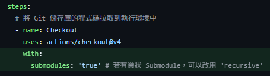

# 如何在其他專案引用此專案
- 使用 Git Submodule
1. 將 [ImportSeanToolDotScripts.ps1](../Shell/Windows/PowerShell/Git/ImportSeanToolDotScripts.ps1) 複製到你的專案中
    - 
2. 執行該腳本
    - 
    - 
3. 將 ``.gitmodules`` 與 ``SeanTool.Scripts`` 兩個檔案加入版本控制
    - 

# 重新 clone 專案 SeanTool.Scripts 是空的
1. 將 [CloneSeanToolDotScripts.ps1](../Shell/Windows/PowerShell/Git/CloneSeanToolDotScripts.ps1) 複製到你的專案中
2. 執行該腳本

# 更新專案 SeanTool.Scripts 的內容
1. 將 [UpdateSeanToolDotScripts.ps1](../Shell/Windows/PowerShell/Git/UpdateSeanToolDotScripts.ps1) 複製到你的專案中
2. 執行該腳本
3. 將 ``SeanTool.Scripts`` Link 檔案更新 git
    

# 在其他專案的自動化流程中有使用到此專案的腳本
- 因為是以 Git Submodule 的方式引入，actions/checkout@v4 預設不會自動下載 Submodules 的內容
- 需於 checkout 步驟加上 with: submodules: true 參數
- 